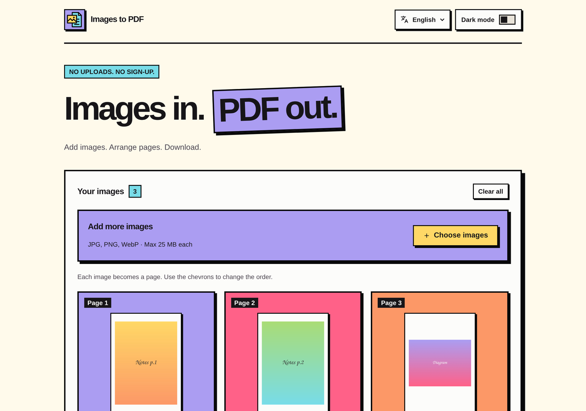
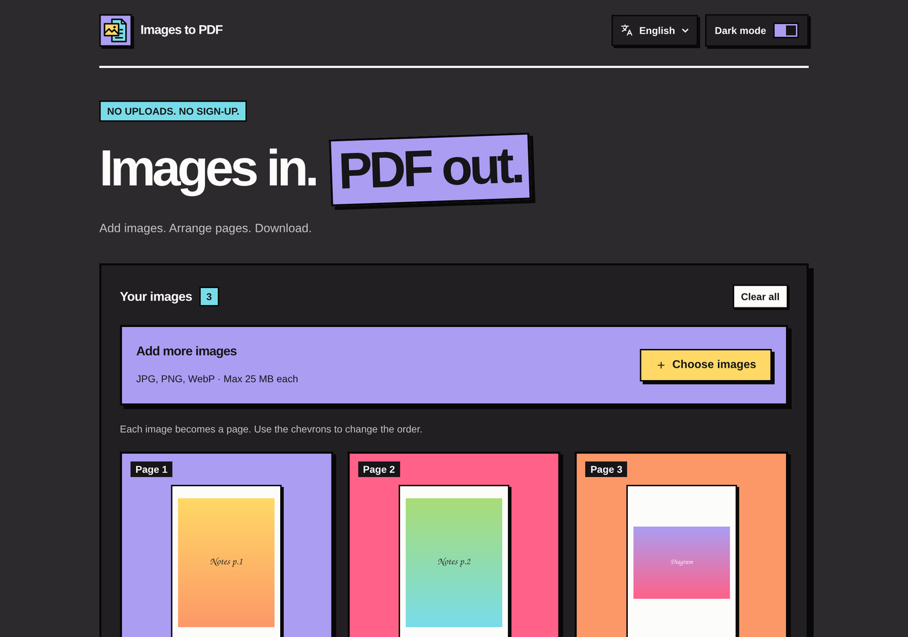
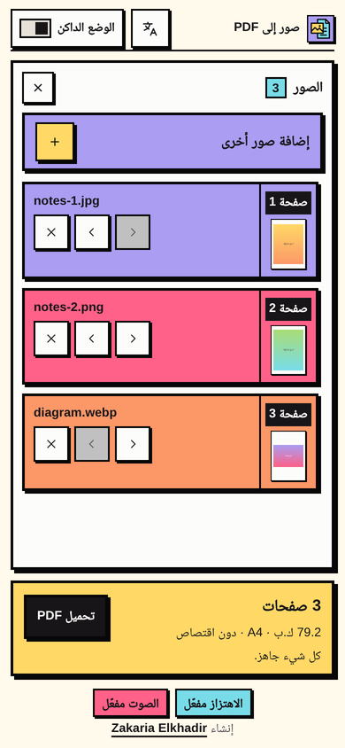

# Images to PDF

**Combine JPG, PNG, and WebP images into one PDF in your browser. Your files stay on your device.**

[**Try it live →**](https://zakariaelkhadir.github.io/images-to-pdf/) · No uploads · No sign-up · Works offline · [MIT licensed](LICENSE)



## Features

- **Private.** The app converts images in your browser and never uploads them to a server.
- **Arranges pages.** Move pages earlier or later, or remove them, before you download.
- **Fits A4 pages.** Each image fills one A4 page without cropping.
- **Accepts common formats.** JPG, PNG, and WebP files up to 25 MB each. Pick files or drag them onto the page.
- **Speaks three languages.** English, French, and Arabic, with a right-to-left layout for Arabic.
- **Includes dark mode.** The app remembers your theme and language.
- **Runs without dependencies.** Plain HTML, CSS, and JavaScript, with no build step, framework, or third-party PDF library.

<p align="center">
  
  &nbsp;
  
</p>

## Why I built it

I needed to turn some private images into a PDF, and I wanted to keep them on my device without sending them to an online converter or an AI tool. I built Images to PDF for that job and decided to share it with students who need to turn photos of notes, scans, or assignments into a PDF while keeping their files private.

## How to use it

1. Open the [live app](https://zakariaelkhadir.github.io/images-to-pdf/) or a local copy.
2. Choose images, or drag them onto the page.
3. Use the chevrons to change the page order, and the × button to remove a page.
4. Select **Download PDF**.

## Run locally

Open `dist/index.html` in a modern browser. Keep the `assets/`, `css/`, and `js/` folders next to it. The app works offline.

To serve the same files over HTTP from the repository root, run:

```sh
python3 -m http.server 8000 --bind 127.0.0.1 --directory dist
```

Then open `http://localhost:8000`.

## Project structure

| File | What to edit |
| --- | --- |
| `dist/index.html` | Page structure, controls, and dialogs |
| `dist/assets/logo.svg` | Header logo and browser icon |
| `dist/assets/social-card.png` | Image shown when people share the link |
| `dist/css/styles.css` | Colors, components, and animations |
| `dist/css/responsive.css` | Phone layout and reduced motion |
| `dist/js/app.js` | File selection, image order, and conversion flow |
| `dist/js/pdf.js` | Image encoding, A4 placement, and PDF output |
| `dist/js/i18n.js` | English, French, and Arabic strings and number formatting |
| `dist/js/language-menu.js` | Language selection, keyboard controls, and focus |
| `dist/js/preferences.js` | Saved preferences and theme setup before the page renders |
| `dist/js/feedback.js` | Sound, vibration, and interaction animations |

### Translations

Use the same keys and placeholders in all three language dictionaries in `dist/js/i18n.js`. Arabic uses a right-to-left layout. Sound and haptics depend on browser and device support.

## Deploy to GitHub Pages

Set **Settings → Pages → Source** to **GitHub Actions**. The workflow in `.github/workflows/pages.yml` publishes `dist/` when site files change on `main`. You can also run it from the Actions tab. All site assets use relative paths, so the app works under a repository URL.

## Contributing

Issues and pull requests are welcome. Before you open a pull request, test your change in light and dark mode, in all three languages, and at phone width.

## License

Released under the [MIT License](LICENSE).
